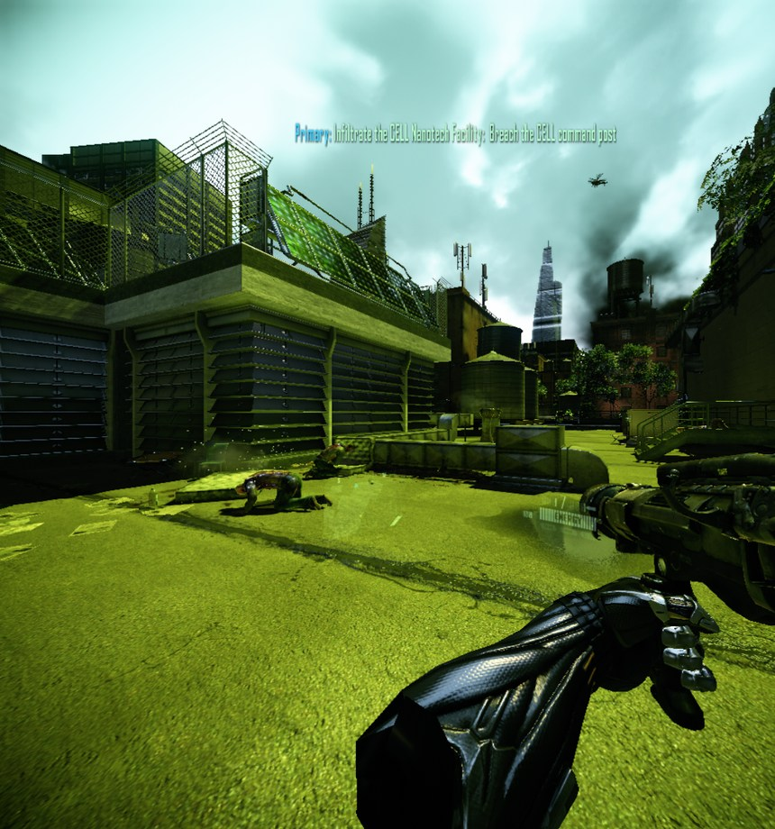

> [!IMPORTANT]
> **💬 DOWNLOAD & DISCUSSION**
>
> **[Join the Flat2VR Discord](https://discord.gg/P4q9zt7ek)** · **[Open the Crysis 2 thread](https://discord.com/channels/747967102895390741/1565752656134144040)**
>
> Download the mod from the Crysis 2 thread and share feedback there.

  

## 📦 INSTALLATION

1. Install the original **Crysis 2** on PC.
2. **Put the mod archive next to `Crysis2.exe`** in `bin32`. Extract the entire archive one level up, into the main Crysis 2 folder. The extracted mod folder should sit beside `bin32`.
3. Connect your PC VR headset, select your OpenXR runtime, and run **`RUN.bat`** from the extracted mod folder.

## ⚡ FEATURES

### 👊 Punch an enemy or swing your weapon

Hit at arm’s length with a bare hand or a held weapon. The controller gives you feedback when a strike connects.

### 🌀 Lift an enemy and throw them across the room

Reach with an empty hand and grip to pull in a prop or enemy. Swing and release to throw it, or press the trigger to shove it away while you hold it.

### 🤲 Draw from your shoulder or hip and swap weapon hands

Reach for your weapon, then pass it into the other hand whenever you want to switch sides. Grab the fore-end with your empty hand for a two-handed grip.

### 🔭 Bring your scope up to your eye

Raise the rifle and look through the optic to see the magnified view. Switch between 4× and 10× on the sniper scope.

### 🌦️ Return to the same streets under a different sky

Time of day, rain, wind and lighting can change the atmosphere from one run to the next.

### 🛠️ Take a mounted gun with you

Use your free hand to interact with a mounted gun. Hold the interact trigger to detach it from mounts that support it.

## 📸 In-game screenshots

  
  

[Tester credits](TESTERS.md)

## 🎮 Other VR mods

| VR mod | Highlights |
| --- | --- |
| [Alone in the Dark (2008) VR](https://github.com/Monsterdeadwood/AloneInTheDark2008VR) | Aim a light by hand, carry a chair, and throw bottles |
| [Battlefield 3: VRevamp](https://github.com/Monsterdeadwood/Battlefield-3-VRevamp) | Pull dropped guns toward you, draw from body slots, and fight through changing weather |
| [Burnout Paradise Remastered VR](https://github.com/Monsterdeadwood/BUrnOutPvr) | Pull the handbrake, hit boost, and look around while racing |
| [NOVA · CS:GO Legacy VR](https://github.com/Monsterdeadwood/CSGOVR) | Aim and feel recoil, take scoped shots, and buy gear from the controllers |
| [Metro 2033 VR](https://github.com/Monsterdeadwood/Metro2033VR) | Lift an enemy, shock them with your hand, or bounce a glowing core down a tunnel |
| [Rainbow Six Siege VR](https://github.com/Monsterdeadwood/SiegeVR) | Brace a rifle by its foregrip, drop prone and use gadgets |
| [Star Wars: The Force Unleashed II VR](https://github.com/Monsterdeadwood/TFU2VR) | Ignite two sabers independently, cut limbs, and ride a crate with the Force |
| [TimeShift VR](https://github.com/Monsterdeadwood/TimeShiftVR) | Punch or hit with your weapon, control time, and fight through changing weather |
| [Titanfall 1 VR](https://github.com/Monsterdeadwood/Titanfall1VR) | Call and board a Titan, catch shots with Vortex, and eject |
| [You Are Empty: Absolute Edition VR](https://github.com/Monsterdeadwood/YouAreEmptyAEVR) | Shoot with one hand, hit with either, and reach out against walls |
