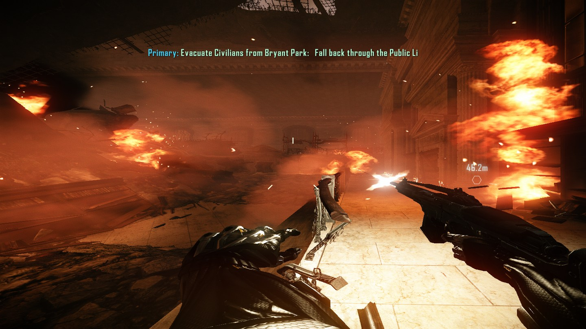

> [!IMPORTANT]
> **DOWNLOAD & DISCUSSION**
>
> **[Join the Flat2VR Discord](https://discord.gg/P4q9zt7ek)** · **[Open the Crysis 2 thread](https://discord.com/channels/747967102895390741/1565752656134144040)**
>
> Download the mod from the Crysis 2 thread and share feedback there.

  

## Features

**Stereo head tracking · Left- and right-hand weapon control · Physical melee · Telekinesis · Randomized weather and time of day**

###  Punch an enemy or swing your weapon

Hit at arm’s length with a bare hand or a held weapon. The controller gives you feedback when a strike connects.

###  Lift an enemy and throw them across the room

Reach with an empty hand and grip to pull in a prop or enemy. Swing and release to throw it, or press the trigger to shove it away while you hold it.

###  Draw from your shoulder or hip and swap weapon hands

Reach for your weapon, then pass it into the other hand whenever you want to switch sides. Grab the fore-end with your empty hand for a two-handed grip.

###  Bring your scope up to your eye

Raise the rifle and look through the optic to see the magnified view. Switch between 4× and 10× on the sniper scope.

###  Return to the same streets under a different sky

Time of day, rain, wind and lighting can change the atmosphere from one run to the next.

###  Take a mounted gun with you

Use your free hand to interact with a mounted gun. Hold the interact trigger to detach it from mounts that support it.

## Installation

1. Install the original **Crysis 2** on PC.
2. **Put the mod archive next to `Crysis2.exe`** in `bin32`. Extract the entire archive one level up, into the main Crysis 2 folder. The extracted mod folder should sit beside `bin32`.
3. Connect your PC VR headset, select your OpenXR runtime, and run **`RUN.bat`** from the extracted mod folder.

## In-game screenshots

  
  

[Tester credits](TESTERS.md)

## Other VR mods

| VR mod | Highlights |
| --- | --- |
| [Alone in the Dark (2008) VR](https://github.com/Monsterdeadwood/AloneInTheDark2008VR) | Sweep a flashlight across the room, then grab a chair and carry it by hand. |
| [Battlefield 3: VRevamp](https://github.com/Monsterdeadwood/Battlefield-3-VRevamp) | Pull a dropped enemy rifle toward you, take it with your other hand and fire. |
| [Burnout Paradise Remastered VR](https://github.com/Monsterdeadwood/BUrnOutPvr) | Look into a corner, drift through it and hit boost as you straighten out. |
| [NOVA · CS:GO Legacy VR](https://github.com/Monsterdeadwood/CSGOVR) | Bring the AWP’s scope up to your eye and feel the kick when you shoot. |
| [Metro 2033 VR](https://github.com/Monsterdeadwood/Metro2033VR) | Ricochet a glowing power core down a tunnel and watch it light the walls as it travels. |
| [Rainbow Six Siege VR](https://github.com/Monsterdeadwood/SiegeVR) | Reach for the rifle’s foregrip and steer the muzzle with both hands. |
| [Star Wars: The Force Unleashed II VR](https://github.com/Monsterdeadwood/TFU2VR) | Hold a Stormtrooper in the air with the Force and swing a lightsaber with your other hand. |
| [TimeShift VR](https://github.com/Monsterdeadwood/TimeShiftVR) | Let go of the foregrip for a quick punch, or strike with the rifle itself. |
| [Titanfall 1 VR](https://github.com/Monsterdeadwood/Titanfall1VR) | Call down a Titan, climb in and send captured shots back with the Vortex Shield. |
| [You Are Empty: Absolute Edition VR](https://github.com/Monsterdeadwood/YouAreEmptyAEVR) | Keep your gun trained ahead with your right hand and strike with your free left. |
