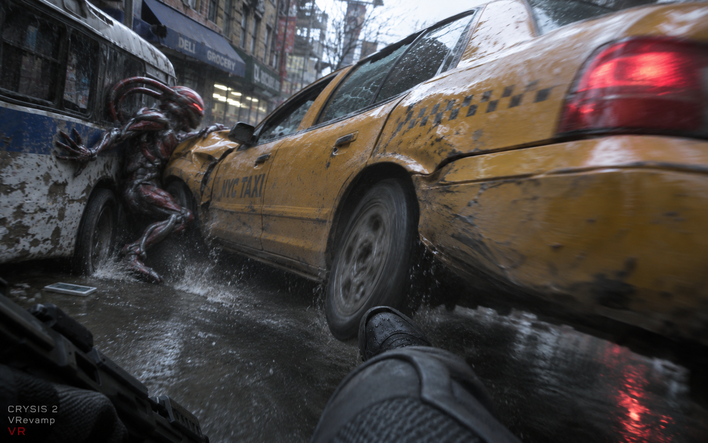

> [!IMPORTANT]
> **[TEST BUILDS & DISCUSSION · FLAT2VR DISCORD](https://discord.gg/P4q9zt7ek)**
> Testing, build requests, feedback and discussion happen in the **Flat2VR Modding Discord**. Join the server and find the **Crysis 2** thread.

  

# Crysis 2: VRevamp

[Flat2VR Discord](https://discord.gg/P4q9zt7ek) · [All projects](PORTFOLIO.md)

Experience the original Crysis 2 in VR with tracked viewing, controller-directed weapons, physical melee and object interaction. Choose the R8.2 campaign preview or the separate R18 Downtown Rooftop Arsenal, with 48 test loadouts across 22 weapon models.

**Package baseline on this page: R8.2 campaign preview / R18 Rooftop Arsenal.**

## Installation

| Package | Purpose | Supported game |
| --- | --- | --- |
| **R8.2** | Campaign / Battery Park transition test | Supported original retail and reported EA/Origin EXE + DX11 renderer families. |
| **R18** | Downtown Rooftop Arsenal: 48 loadouts, 22 weapon models | Original supported retail DX11 build. Matching Steam EXE is recognized but needs field testing. EA/Origin is outside this rooftop package’s support. |

1. Choose a **Crysis 2 OpenXR** package matching your game edition in the Crysis 2 thread on Flat2VR; compare the two package rows above.
2. Extract the complete mod folder into the game directory, beside **bin32**.
3. Connect PC VR and select your 64-bit OpenXR runtime, then open **RUN.bat** inside the mod folder.
4. R8.2 uses the normal campaign menu. R18 loads its included Downtown rooftop checkpoint directly. Keep the launcher open. If detection needs help, set game_path in config/settings.json.

Current test-package availability is coordinated in Discord. Use the complete package for your supported game build; this project page is separate from a release download.

## What this project brings to VR

- Stereo VR viewing, tracked weapons and the existing motion-controller gameplay.
- Physical melee and native object pulling, holding and throwing in the existing gameplay branch.
- A compact translucent HUD with subtle delayed motion and preserved binocular depth.
- A spatial movie screen you can look away from; tap Left Menu to recenter it.
- FSR 1 image scaling and startup fixes for the supported retail and reported EA renderer families.
- R8.2 addresses the reported Battery Park crash after the Prophet cinematic.

<b>R18 Rooftop controller quick reference</b>

| Input | Action |
| --- | --- |
| Left stick / click | Head-relative move / sprint |
| Right stick horizontal / click | Turn / crouch-stand |
| Right stick up / down | Armor / cloak; return to center between activations |
| Right trigger / right grip | Fire / reload |
| Left trigger | Interact, pick up or enter a mounted gun; on the R18 roof, equip the weapon you look at |
| Left grip | Pull/hold objects, or support the gun near its front grip; release a held object to throw |
| A / Y | Jump / grenade |
| B tap / hold | Ordinary weapon cycle / native weapon customization |
| X tap / hold | Select heavy/explosive weapons / change fire mode; R18 DSG1 scope: X selects 4×/10× |
| Left Menu tap / hold | Recenter / pause after 0.65 seconds |

The complete package control sheet takes precedence for its version and interaction profile.

This table describes the R18 layout. For R8.2, use the CONTROLS_EN.txt supplied in that campaign package; the two packages have separate gameplay revisions.

## Features in newer test builds

- **Native weapon handling prototype.** The XR Sim test passed the same weapon between hands, pulled a weapon from the world with either hand and picked it up with the other. A supporting hand holds the game's grip point and can steer the weapon.
- **Two independent weapons and body storage.** The same test exercised draws from body slots, separate firing and button reloads, and dropping a weapon into the game's physics. Visual alignment still needs a player test.
- **Trigger feedback prototype.** The test route produced squeeze buildup, a break cue and confirmed-shot feedback. The original OpenXR host and physical headset feel still need their own checks.

## Current status

**Experimental preview.** The main HUD changes and supported retail/EA startup paths were checked in the actual game with XR Sim.

- This targets original Crysis 2; Crysis 2 Remastered is outside this package’s support.
- Physical-headset comfort, the Battery Park headset retest and full campaign coverage remain open.

R18 adds fitted sights, supporting-hand grip, supported manual magazine handling and a DSG1 4×/10× scope test on the rooftop. Its retail-game checks used XR Sim; physical comfort and Steam launch still need feedback.

A separate independent weather experiment drives native time-of-day, sky, rain and wind controls. It is outside both documented test packages.

[Detailed status and validation scope](docs/PROJECT_STATUS.md)

## Testing & feedback

Post in the game’s [Flat2VR thread](https://discord.gg/P4q9zt7ek) with your **mod version, game/store version, headset, OpenXR runtime, GPU, reproduction steps and the package’s diagnostic ZIP**. A short video is helpful for visual or handling problems.

<!-- COMMUNITY_TESTERS_START -->
## ❤️ Community testers — thank you!

These VR projects improve thanks to the people sharing test reports, logs, videos and practical feedback across the portfolio.

alvaro · Arkturus [CODA] · Arkturus Primacronus [HD2M] · Arthur G [ORE] · Bestgamer3 · Chtiblue · creative name [SC℧M] · Derp Dog · DNana51 [R1Δ] · Gritt [F2VR] · headbangerle. · huligan01 · jeremiasadasmki · Kerin\_Serica [1984] · kilo · Lawyer [WYRD] · little\_boxbr · Lord Beardsteak · MeWhenINameMyself · MetalikSix · neoz\_1980 · Notagameaddict · Pelmeschka · Potato Pancake Person · ReseTV · Rusty Gere · SilentBang [LTS] · SilentVortigaunt · Terry · ThE LaNd GuLl · Thomas-3D-VR · Uruz [F2VR] · Willthethrill · wxorys\_ · Xavier H. G.

[Full community credits, games, feedback contributors and testing volunteers](TESTERS.md).

The linked list shows which games each person helped with. Thank you as well to everyone whose reports arrived without a public display name.

<!-- COMMUNITY_TESTERS_END -->

## Other VR mods by Monsterdeadwood

| Game / project | Focus | Visibility |
| --- | --- | --- |
| [Assassin’s Creed VR](https://github.com/Monsterdeadwood/AC1VR) | First-person exploration, climbing and sword interaction | Private |
| [Star Wars: The Force Unleashed II VR](https://github.com/Monsterdeadwood/TFU2VR) | Dual lightsabers, independent telekinesis and Force powers | Public |
| [NOVA · CS:GO Legacy VR](https://github.com/Monsterdeadwood/CSGOVR) | CS:GO Legacy local matches with motion controls | Public |
| [TimeShift VR](https://github.com/Monsterdeadwood/TimeShiftVR) | Time powers, nine weapons and roomscale posture | Public |
| [You Are Empty: Absolute Edition VR](https://github.com/Monsterdeadwood/YouAreEmptyAEVR) | Absolute Edition VR, weapons and hand interaction | Public |
| [Alone in the Dark 2008 VR](https://github.com/Monsterdeadwood/AloneInTheDark2008VR) | Survival-horror VR and held-item interaction | Public |
| [Rainbow Six Siege VR](https://github.com/Monsterdeadwood/SiegeVR) | Legacy Siege stereo and tracked weapon handling | Public |
| [Burnout Paradise Remastered VR](https://github.com/Monsterdeadwood/BUrnOutPvr) | Stereo driving, vehicle menus and native effects | Public |
| [Titanfall 1 VR](https://github.com/Monsterdeadwood/Titanfall1VR) | Pilot combat and Titan cockpit VR | Public |
| [Metro 2033 VR](https://github.com/Monsterdeadwood/Metro2033VR) | Original Metro VR and native physics experiments | Public |
| [Insurgency VR](https://github.com/Monsterdeadwood/InsurgencyVR) | Early VR integration research | Private |
| [Counter-Strike: Source VR](https://github.com/Monsterdeadwood/CSSVR) | Counter-Strike: Source VR development | Private |

Private repository links are available to invited collaborators. Public project pages are marked above.

## Credits & development notes

Project maintained by [Monsterdeadwood](https://github.com/Monsterdeadwood). This is an independent fan VR project; you need your own supported copy of the original game.

[Previous repository overview, preserved as history](README_RESEARCH_ARCHIVE.md).

Documentation reviewed: **14 November 2026**.
