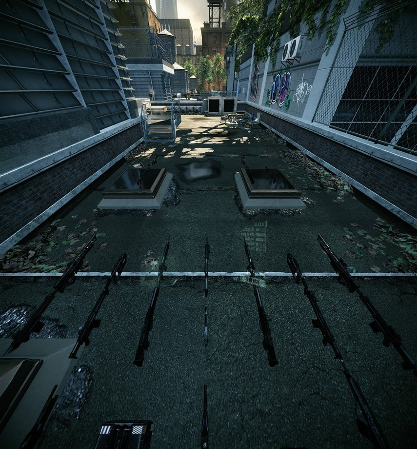

> [!IMPORTANT]
> **💬 TEST BUILDS & DISCUSSION**
>
> **[Join the Flat2VR Discord](https://discord.gg/P4q9zt7ek)** · **[Open the Crysis 2 thread](https://discord.com/channels/747967102895390741/1565752656134144040)**
>
> Download the latest test build from the thread, or ask for a specific test variant. Share feedback in the same thread.

  

## 📦 INSTALLATION

1. Install the original **Crysis 2** and pick a test build for your edition. The campaign and rooftop builds have different requirements; see **Build details** below.
2. Extract the entire mod folder into the game directory, next to **`bin32`**.
3. Connect PC VR, select your 64-bit OpenXR runtime, and run **`RUN.bat`** in the mod folder.

## ⚡ FEATURES

### A ROOFTOP FULL OF WEAPONS

R18 gives you 48 test loadouts across 22 original weapon models, with fitted sights, a supporting grip, and a 4×/10× DSG1 scope test.

### PULL, HOLD & THROW OBJECTS

Use your tracked hand to pull a prop in, hold it, or throw it back into the scene. The campaign preview also adds physical melee.

### BODY HOLSTERS & TWO INDEPENDENT GUNS

A separate development build tested drawing from body slots, passing a gun between hands and firing or reloading each hand independently.

### A HUD AND MOVIES THAT SIT IN SPACE

The HUD has depth and follows with a slight delay. Cutscenes play on a screen you can look away from and recenter.

The rooftop and campaign packages cover different game builds. Crysis 2 Remastered requires its own mod.

## 📸 In-game screenshots

  
  

[Tester credits](TESTERS.md) · [Build details](docs/PROJECT_STATUS.md)

## 🎮 Other VR mods

| VR mod | Highlights |
| --- | --- |
| [Alone in the Dark (2008) VR](https://github.com/Monsterdeadwood/AloneInTheDark2008VR) | Tracked item handling and hand contact with walls |
| [Battlefield 3: VRevamp](https://github.com/Monsterdeadwood/Battlefield-3-VRevamp) | Body holsters, two-handed aiming, and changing campaign skies |
| [Burnout Paradise Remastered VR](https://github.com/Monsterdeadwood/BUrnOutPvr) | Head-tracked driving with stereo boost and exhaust effects |
| [NOVA · CS:GO Legacy VR](https://github.com/Monsterdeadwood/CSGOVR) | Controller aiming and working optics in local bot matches |
| [Metro 2033 VR](https://github.com/Monsterdeadwood/Metro2033VR) | Telekinesis, hand lightning, and object physics |
| [Rainbow Six Siege VR](https://github.com/Monsterdeadwood/SiegeVR) | Tracked weapons and two-handed foregrip handling |
| [Star Wars: The Force Unleashed II VR](https://github.com/Monsterdeadwood/TFU2VR) | Two tracked lightsabers and independent Force grip |
| [TimeShift VR](https://github.com/Monsterdeadwood/TimeShiftVR) | Randomized weather, day and night, and roomscale crouching |
| [Titanfall 1 VR](https://github.com/Monsterdeadwood/Titanfall1VR) | Aim with the controller and look around a Titan cockpit |
| [You Are Empty: Absolute Edition VR](https://github.com/Monsterdeadwood/YouAreEmptyAEVR) | Tracked weapons and melee with either hand |
