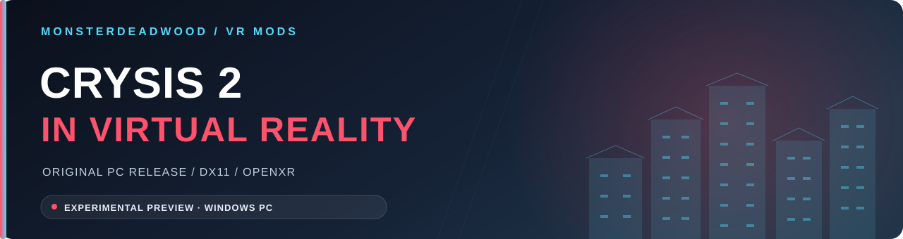

> [!IMPORTANT]
> **[ТЕСТИРОВАНИЕ И ОБСУЖДЕНИЕ · FLAT2VR DISCORD](https://discord.gg/P4q9zt7ek)**
> Тестирование, запрос сборок, отзывы и обсуждение проходят в **Flat2VR Modding Discord**. Перейди на сервер и найди тему **Crysis 2 VR**.

# Crysis 2 VR

[English](README.md) · [Русский](README_RU.md) · [Flat2VR Discord](https://discord.gg/P4q9zt7ek) · [All projects](PORTFOLIO.md)

Оригинальная Crysis 2 в VR: обзор шлемом, оружие от контроллеров, физический ближний бой и взаимодействие с предметами. Общественная ветка развивает читаемый HUD, пространственные экраны видео и переходы кампании.

**Текущая описанная ветка: R8.2 community preview.**

## Установка

1. Возьми актуальную сборку **Crysis 2 OpenXR** в теме Crysis 2 на Flat2VR. Нужна **оригинальная PC-игра с поддерживаемым DX11-рендерером**.
2. Распакуй полную папку мода в каталог игры рядом с **bin32**.
3. Подключи PC VR и выбери свой OpenXR runtime, затем открой **RUN.bat** в папке мода.
4. Выбери новую кампанию или загрузку в обычном меню. Оставь окно запуска открытым. Если игра не найдена, укажи game_path в config/settings.json.

Доступность актуальных тестовых пакетов уточняется в Discord. Нужен полный пакет для поддерживаемой версии игры; страница проекта сама по себе не является скачиваемым релизом.

## Что есть в проекте

- Стереообзор, оружие от контроллеров и игровое управление в VR.
- Физический ближний бой, притягивание, удержание и бросок предметов в игровой ветке.
- Компактный полупрозрачный HUD с небольшим плавным движением и сохранённой стереоглубиной.
- Пространственный экран видео, от которого можно отвернуться; Left Menu возвращает его в центр.
- Масштабирование FSR 1 и исправления запуска для поддерживаемых retail- и EA-версий рендерера.
- R8.2 исправляет воспроизведённый сбой Battery Park после сцены с Prophet.

<b>Краткое управление</b>

| Действие / кнопка | Назначение |
| --- | --- |
| Left Menu tap / hold | Сброс камеры / пауза после 0,65 секунды |
| Left stick in menus | Навигация |
| A / right trigger in menus | Подтвердить |
| B in menus | Назад |
| CONTROLS_EN.txt in the package | Полная игровая раскладка в сборке |

Полная инструкция управления в конкретной сборке учитывает её версию и профиль контроллеров.

## Текущий статус

**Экспериментальная сборка.** Основные изменения HUD и поддерживаемые retail/EA-маршруты запуска проверены в настоящей игре через XR Sim.

- Эта сборка рассчитана на оригинальную Crysis 2; Remastered ею не поддерживается.
- Удобство в физическом шлеме, повтор перехода Battery Park в шлеме и вся кампания ещё требуют проверки.

Отдельно развиваются тестовый арсенал на крыше и независимая погода. Погодный эксперимент управляет родными временем суток, небом, дождём и ветром и отделён от R8.2.

[Подробный статус и область проверки](docs/PROJECT_STATUS.md)

## Тестирование и отзывы

Напиши в [тему игры на Flat2VR](https://discord.gg/P4q9zt7ek): укажи **версию мода, игру/магазин, шлем, OpenXR runtime, GPU, шаги воспроизведения и диагностический ZIP сборки**. Для проблем изображения или управления полезно короткое видео.

## Другие мои VR-моды

| Игра / проект | Направление | Доступ |
| --- | --- | --- |
| [Battlefield 3 VR](https://github.com/Monsterdeadwood/BF3VR) | Кампания, оружие и руки | Закрытый |
| [Assassin’s Creed VR](https://github.com/Monsterdeadwood/AC1VR) | Обзор от первого лица, лазание и меч | Закрытый |
| [NOVA · CS:GO Legacy VR](https://github.com/Monsterdeadwood/CSGOVR) | Локальные матчи CS:GO Legacy с VR-управлением | Закрытый |
| [TimeShift VR](https://github.com/Monsterdeadwood/TimeShiftVR) | Управление временем, девять видов оружия и позы | Закрытый |
| [You Are Empty: Absolute Edition VR](https://github.com/Monsterdeadwood/YouAreEmptyAEVR) | Absolute Edition в VR, оружие и взаимодействие | Открытый |
| [Alone in the Dark 2008 VR](https://github.com/Monsterdeadwood/AloneInTheDark2008VR) | VR-хоррор и взаимодействие с предметами | Открытый |
| [Rainbow Six Siege VR](https://github.com/Monsterdeadwood/SiegeVR) | Стерео и оружие от контроллеров в старой Siege | Открытый |
| [Burnout Paradise Remastered VR](https://github.com/Monsterdeadwood/BUrnOutPvr) | Стереовождение, меню автомобилей и эффекты | Закрытый |
| [Titanfall 1 VR](https://github.com/Monsterdeadwood/Titanfall1VR) | Бой пилота и кабины титанов | Закрытый |
| [Metro 2033 VR](https://github.com/Monsterdeadwood/Metro2033VR) | Оригинальная Metro в VR и нативная физика | Открытый |
| [Insurgency VR](https://github.com/Monsterdeadwood/InsurgencyVR) | Начальная подготовка VR-интеграции | Закрытый |
| [Counter-Strike: Source VR](https://github.com/Monsterdeadwood/CSSVR) | Разработка VR для Counter-Strike: Source | Закрытый |

Ссылки на закрытые репозитории доступны приглашённым участникам. Открытые страницы отмечены в таблице.

## Авторство и заметки разработки

Проект ведёт [Monsterdeadwood](https://github.com/Monsterdeadwood). Это независимый фанатский VR-проект; нужна собственная поддерживаемая копия оригинальной игры.

[Прежний обзор репозитория, сохранённый как история](README_RESEARCH_ARCHIVE.md).

Описание сверено: **14 ноября 2026 года**.
